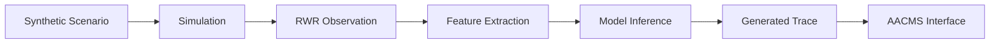
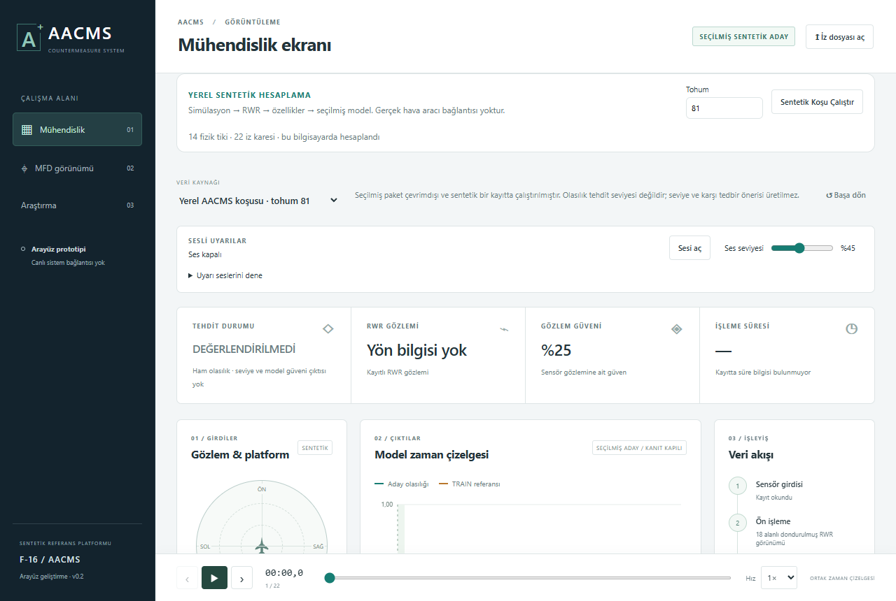
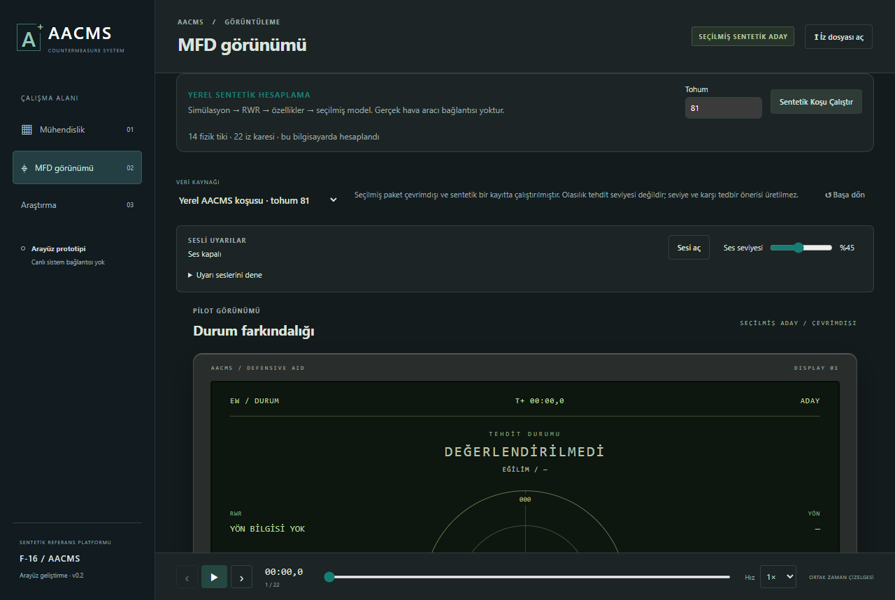

# AACMS Prototype

**AI-Assisted Countermeasure Management System** — an interactive Windows research prototype for synthetic threat assessment and decision-support experimentation.

## Project Overview

AACMS connects synthetic scenario execution, simulated radar warning receiver (RWR) observations, feature extraction, model inference, and trace visualization in one interactive application. It provides a functional environment for inspecting how these stages behave together over time.

## Purpose / Motivation

The project explores the relationship between simulated observations, model output, and an operator-facing interface. Reproducible local runs and recorded traces support research into temporal behavior, evidence limitations, and the presentation of decision-support information.

## Prototype Capabilities

- Local synthetic scenario execution with a user-selected seed.
- Simulation, RWR observation processing, feature extraction, and model inference.
- Generated trace visualization and recorded scenario playback.
- Engineering and MFD-style views with synchronized time controls.
- Compatible JSON trace import.
- An audio warning system with volume, mute, playback, and manual preview controls.

## System Architecture

A Windows application shell presents the interface and connects it to the local AACMS computation runtime. The runtime executes the synthetic research workflow and returns a trace for inspection. Recorded traces can also be opened directly.

See the [system architecture](docs/system-architecture/README.md).

## Component Architecture

The main components are the Windows shell, presentation interface, local computation runtime, packaged inference resources, trace adapter, and audio subsystem. Training tools and development datasets are outside the distributed prototype.

See the [component diagram](docs/component-diagram/README.md).

## Prototype Workflow

The local run is computed on the user's computer. It is not a sequence of pre-rendered screens. The interface also supports independently selected presentation scenarios and previously recorded research traces.

## Technologies

| Area | Technologies |
|---|---|
| Computation | Python, NumPy |
| Structured data validation | JSON Schema, Referencing |
| Interface | HTML, CSS, JavaScript |
| Windows application shell | pywebview, Microsoft WebView2, .NET Framework |
| Standalone distribution | Nuitka |

## Engineering Interface

The engineering view brings observation fields, available model output, a timeline, and processing context together. Shared playback controls allow a recorded or generated trace to be paused, stepped through, and inspected.

## MFD Interface

The MFD-style view presents the same trace in a compact instrument-inspired layout. Its visual vocabulary is used for research and interface evaluation; it is not a certified cockpit display.

## Audio Warning System

Audio can be enabled explicitly, adjusted, and muted. The prototype includes event-related announcements, a high-threat presentation loop, and an alert-preview menu. Missile direction and High/Low preview cues remain manual demonstrations; they do not indicate a computed missile detection or operational warning.

## Screenshots

These images show a locally generated synthetic run in the Windows prototype's interface. Details about how they were captured are in [screenshots](docs/screenshots/README.md).

## Windows Prototype

AACMS Prototype v0.1 is a standalone Windows x64 distribution. It includes the audio fixes and expanded warning-preview controls. Basic functionality has also been tested on a separate Windows computer, with no issues reported in those checks.

## Download

The Windows package will be published through GitHub Releases as `AACMS-Prototype-v0.1-Windows.zip`. A direct v0.1.0 release link will be added after publication. The executable and ZIP are not committed to this repository.

## Installation / Running

1. Download `AACMS-Prototype-v0.1-Windows.zip` from the release assets.
2. Extract the ZIP completely.
3. Open the `AACMS-Prototype` folder.
4. Run `AACMS.exe`.

Keep the executable with its supplied runtime files. Run it from the extracted folder, rather than directly from the ZIP. This unsigned prerelease may trigger a Windows SmartScreen publisher warning.

For interface controls and JSON import, see the [running instructions](demo/calistirma-talimatlari.md).

## System Requirements

- Windows 10 or Windows 11, x64. Development validation used Windows 11; Windows 10 coverage has not been completed.
- Microsoft Evergreen WebView2 Runtime. Install it from [Microsoft's official WebView2 page](https://developer.microsoft.com/en-us/microsoft-edge/webview2/) if it is missing.
- Microsoft .NET Framework 4.6.2 or later; an installed newer 4.x version satisfies this prerequisite.
- A writable folder for the extracted package and temporary runtime files.

**Python, Node.js, npm, and an IDE are not required.** The ZIP does not bundle the WebView2 browser runtime. After the required Windows runtimes are available, prototype computation and playback work offline. Microsoft describes the runtime requirement in its [WebView2 distribution guidance](https://learn.microsoft.com/en-us/microsoft-edge/webview2/concepts/distribution).

## Prototype Limitations

Local runs use a bounded synthetic scenario. Imported traces must match a supported format. Presentation scenario labels and model probabilities are separate concepts: model output is not a validated threat level, calibrated model confidence, or an operational countermeasure recommendation. Evidence restrictions remain visible in the interface. No model training or automatic countermeasure execution takes place in the distributed application.

## Research / Academic Scope

This release is an interactive research prototype for academic investigation and demonstration. It operates in a synthetic/offline environment and is not connected to real aircraft sensors or avionics.

## Source Code Availability

Source code is not publicly distributed. A compiled prototype is provided for demonstration and research purposes.

This repository contains approved prototype documentation and screenshots. Third-party notices are included in the Windows distribution. No open-source license for the AACMS application is declared by this repository.

Copyright © Ege Uysal.

## Disclaimer

The prototype has not been validated for operational use and is not flight-certified. It is not a real weapon system and does not replace an actual aircraft countermeasure system. Its output is intended for research inspection and demonstration.
