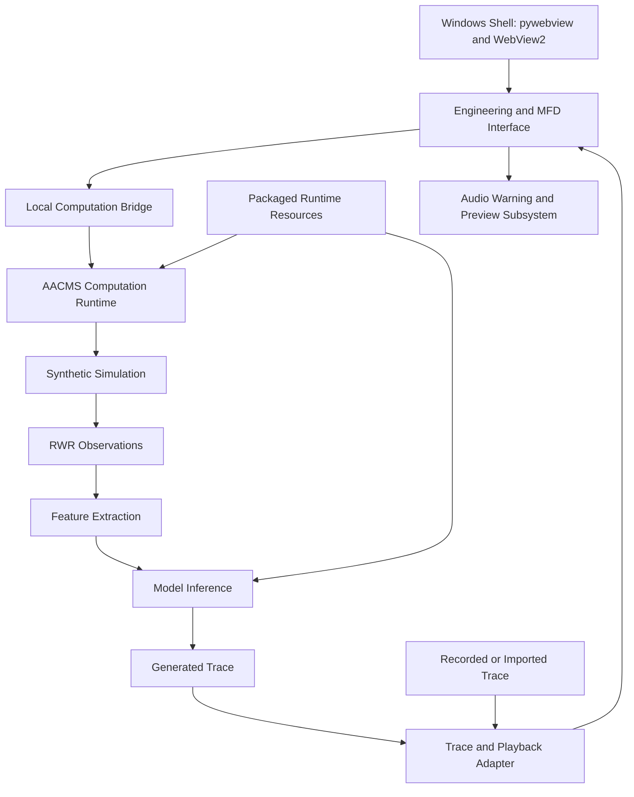

# Component Architecture

| Component | Responsibility |
|---|---|
| Windows shell | Host the interface and connect it to local computation |
| Engineering and MFD interface | Present observations and available assessments over time |
| Computation runtime | Execute the bounded synthetic research workflow |
| Runtime resources | Supply the packaged configuration and inference resources |
| Trace adapter | Normalize supported recorded, imported, and generated traces for playback |
| Audio subsystem | Provide enabled announcements, loop playback, and manual previews |

Development scripts, training tools, evaluation datasets, and private research artifacts are not distributed. Public documentation describes component roles without exposing model parameters or private algorithm implementation.

[Return to AACMS Prototype](../../README.md)
