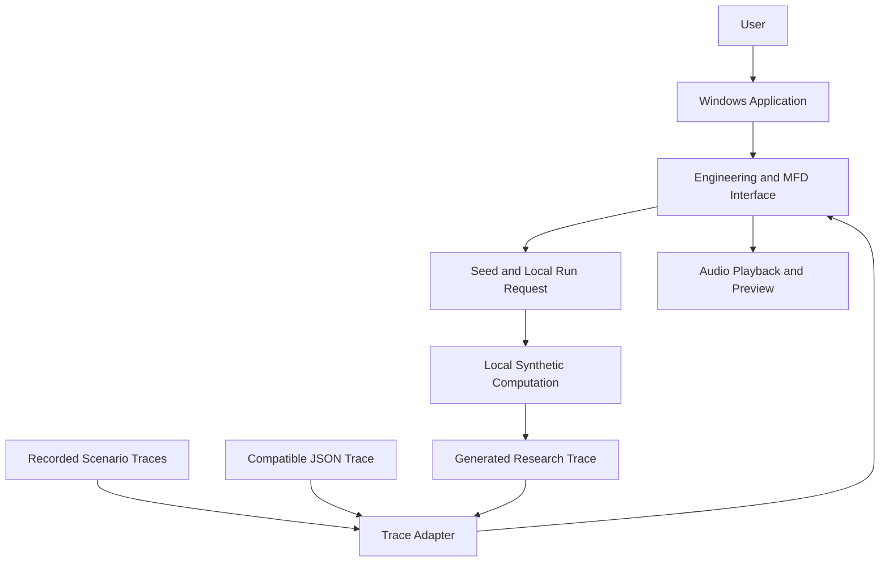

# System Architecture

AACMS Prototype combines an interactive interface with a local synthetic computation workflow. The Windows shell hosts the engineering and MFD views; both views consume the same trace and share playback controls.

## Computation workflow

Synthetic scenario → simulation → RWR observation → feature extraction → model inference → generated trace → AACMS interface.

The packaged inference resources are used locally. Training, model development, and dataset production are outside this distribution. The application has no connection to real aircraft sensors and does not execute aircraft countermeasures.

## Output interpretation

Recorded research output, presentation scenarios, and new local runs retain their respective meanings. Model probabilities are not treated as validated operational threat levels or countermeasure recommendations. Missing observations and unavailable assessments remain visible.

[Return to AACMS Prototype](../../README.md)
